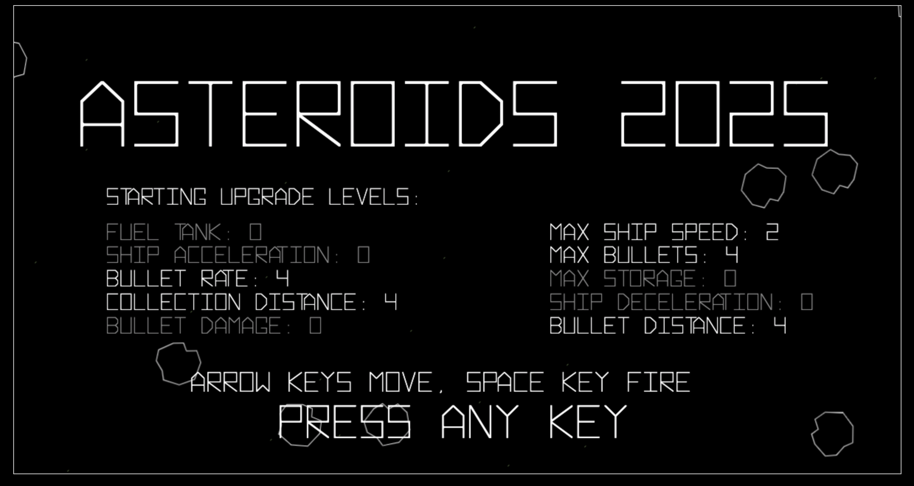
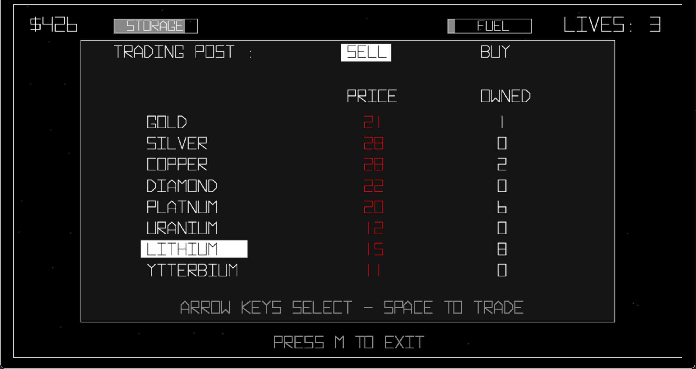
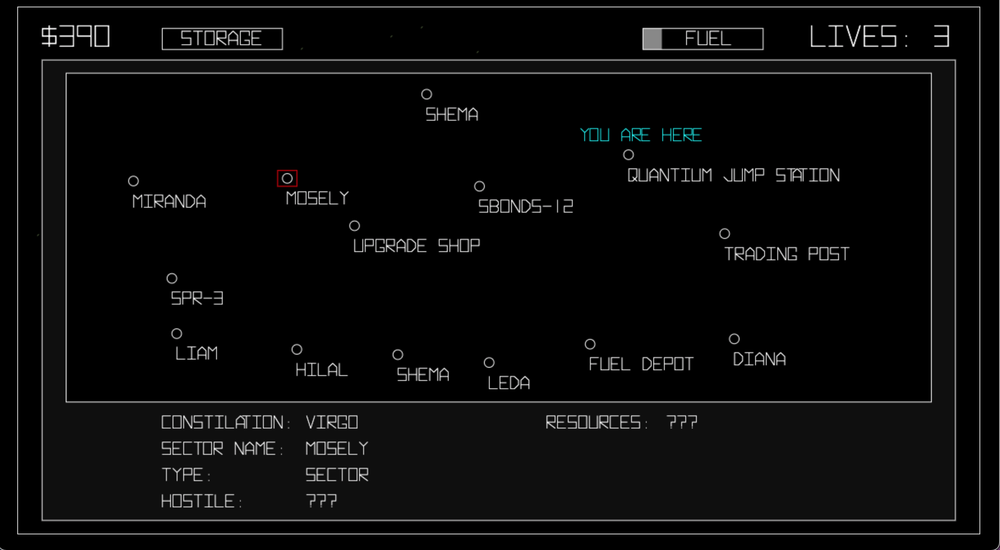

# Asteroids2025

Asteroids clone with RPG elements.

Shoot rocks & alien spaceships

<!--img src="./images/fight.png" alt="Typical gameplay of shooting asteriods" width="600">

Trade resources & buy upgrades

Other stuff to explore

# Play beta version in browser

[Click to play](https://doomlazer.github.io/Asteroids2025)

Controls:

"r" - reroll init stats on title screen

"[ / ]" = change default line width

"w / e" = cycle available missions

", / ." = sell / buy all

"< / >" = sell / buy half

"a" - skip to random song

"s" = toggle mute sound

"S" - toggle mute sfx and speech, play bgm

"+" - debug

USB Controller will ask to define inputs each game1 for now

Note: The current audio system glitches out on Safari causing slow down. Use Chromium browsers until I can resolve that issue. No LLMs were used in the making of this game, except for some web searches which are all stack overflow answers anyhow. 

All music streamed from Archive.org links. No ownership implied.